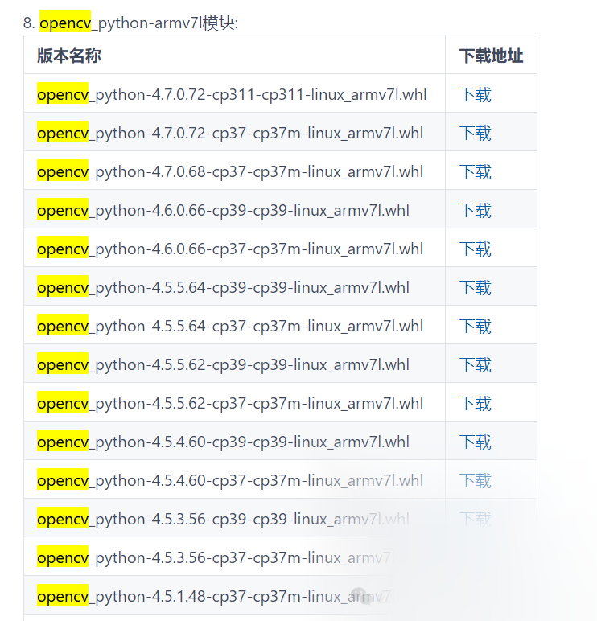

# [python] Install the opencv-python module on Raspberry Pi Armv7l platform via WHL file

Install the `opencv-python` module on a Raspberry Pi using the `.whl` file, follow the steps below. Assuming you have downloaded a compatible `.whl` file for your Raspberry Pi architecture (ARMv7L) and Python version.

#### Step 1: Ensure system updates

First, make sure your Raspberry Pi system is up to date to avoid compatibility issues.

```
sudo apt-get update
sudo apt-get upgrade

-

1

-

2

```

#### Step 2: Install Python and pip

Ensure that your Raspberry Pi is installed with Python and pip. You can install Python3 and pip3 (if not already installed) by running the following commands:

```
sudo apt-get install python3 python3-pip

-

1

```

#### Step 3: Download the `.whl` file

Ensure you have downloaded the `opencv-python` `.whl` file compatible with your Raspberry Pi architecture (ARMv7L) and Python version. You can download it from official sources or reliable resources, such as gitee.com/FIRC/special_whl_chinese_mirror. Search for the corresponding OpenCV module by pressing Ctrl+F, as shown in the figure below.


For example, if the filename you downloaded is `opencv_python-4.x.x-cp37-cp37m-linux_armv7l.whl`, ensure it matches your Python version (such as Python 3.7) and architecture (armv7l).

#### Step 4: Install the `.whl` file

Copy the downloaded `.whl` file to your Raspberry Pi and install it using pip. Assuming the file is saved in the directory `/home/pi/Downloads`.

```
cd /home/pi/Downloads
pip3 install opencv_python-4.x.x-cp37-cp37m-linux_armv7l.whl

-

1

-

2

```

Ensure to replace the filename with the actual filename you downloaded.

#### Step 5: Verification of Installation

You can verify whether `opencv-python` has been successfully installed by running the following command:

```
python3 -c "import cv2; print(cv2.__version__)"

-

1

```

If everything goes well, you should see the output of the installed OpenCV version in the terminal.

#### Notes

1.

Dependencies: Sometimes, OpenCV also requires some additional system dependencies, such as `libjpeg`, `libpng`, `libtiff` and so on. If there are error messages during the installation process indicating that these libraries are missing, they can be installed using `apt-get`.

```
sudo apt-get install libjpeg-dev libpng-dev libtiff-dev

```

-

1

1.

Python version: Ensure that the downloaded `.whl` file matches your Python version. For example, `cp37` indicates Python 3.7, and if you have installed Python 3.8 on your Raspberry Pi, you need to download the corresponding `cp38` file.

1.

Architecture: Ensure that the downloaded `.whl` file matches your Raspberry Pi architecture (ARMv7l).

By following the above steps, you should be able to successfully install the `opencv-python` module on your Raspberry Pi. If you encounter any issues, please check the error messages and make adjustments as needed.


## Payment

Here is a pay link on Stripe ( https://buy.stripe.com/3cs8yP7sY87d0vu9AB ). Please contact me lonlonago@foxmail.com after funding $89, and I will send you a complete data files , thank you!


